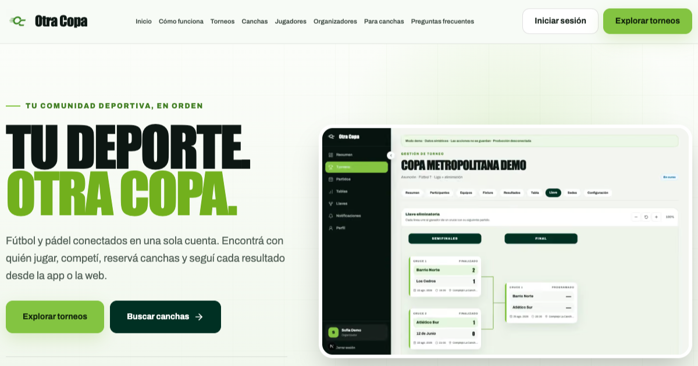

# Otra Copa

> Case study público. El código fuente y la infraestructura permanecen privados.

[Sitio web](https://otracopa.online) · [App Store](https://apps.apple.com/py/app/otra-copa/id6779391553) · [Google Play](https://play.google.com/store/apps/details?id=com.santinopaolisso.otracopa)

## El producto

Otra Copa es una plataforma deportiva publicada en web, iOS y Android para crear, organizar y vivir torneos de fútbol amateur.

## Mi rol

Soy cofundador y desarrollador de producto. Construí la experiencia, la aplicación móvil, el backend, los datos, las integraciones, las pruebas y el proceso de publicación.

## Alcance

- Gestión de torneos, equipos y partidos.
- Aplicación móvil multiplataforma.
- Backend, autenticación, base de datos y seguridad.
- Mapas, notificaciones y publicación en tiendas.
- Más de 100 usuarios registrados, 2 torneos y más de 10 partidos gestionados.

## Tecnologías

Flutter · Dart · Supabase · PostgreSQL · Firebase

## Privacidad

Este repositorio documenta el producto sin exponer código propietario, credenciales, arquitectura sensible ni datos de usuarios.

